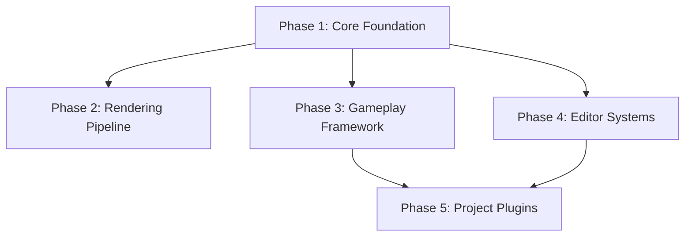

# Unreal Engine Phase Definitions

## Overview
This document defines the modular phases for analyzing Unreal Engine's codebase. Each phase represents a logical grouping of related functionality that can be analyzed independently while maintaining relationships.

## Phase Hierarchy



## Phase 1: Core Foundation
**Priority**: 1 (Must analyze first)
**Estimated Size**: ~5,000 files
**Analysis Time**: 2-3 hours

### Modules Included
- `Core` - Fundamental types, containers, threading
- `CoreUObject` - Object system, reflection, serialization
- `ApplicationCore` - Platform abstraction, application lifecycle
- `Json` - JSON parsing and serialization
- `Projects` - Project and plugin management

### Key Classes to Track
- `UObject` - Base object class
- `FString`, `FName`, `FText` - String types
- `TArray`, `TMap`, `TSet` - Container types
- `FRunnable`, `FThread` - Threading primitives
- `FArchive` - Serialization base

### Why This Phase First
- Everything depends on Core
- Defines fundamental patterns
- Required for understanding any other module

---

## Phase 2: Rendering Pipeline
**Priority**: 2
**Estimated Size**: ~8,000 files
**Analysis Time**: 3-4 hours
**Dependencies**: Core

### Modules Included
- `Renderer` - High-level rendering systems
- `RenderCore` - Core rendering abstractions
- `RHI` - Render Hardware Interface
- `MaterialShaderQualitySettings` - Material system
- `Shaders` - Shader compilation and management

### Key Classes to Track
- `FSceneView` - View representation
- `FMaterial` - Material interface
- `FRHICommandList` - GPU command recording
- `FShader` - Shader base class
- `FRenderTarget` - Render target abstraction

### Relationships to Capture
- Material → Shader dependencies
- RHI → Platform implementations
- Scene → Primitive relationships

---

## Phase 3: Gameplay Framework
**Priority**: 3
**Estimated Size**: ~15,000 files
**Analysis Time**: 5-6 hours
**Dependencies**: Core

### Modules Included
- `Engine` - Main gameplay classes
- `GameplayAbilities` - GAS framework
- `GameplayTags` - Tag system
- `GameplayTasks` - Task system
- `AIModule` - AI systems
- `NavigationSystem` - Pathfinding

### Key Classes to Track
- `AActor` - Base actor class
- `APawn`, `ACharacter` - Controllable entities
- `APlayerController`, `AAIController` - Controllers
- `UActorComponent` - Component base
- `AGameMode`, `AGameState` - Game flow
- `UWorld` - World representation

### Special Patterns
- Actor lifecycle (BeginPlay, Tick, EndPlay)
- Component attachment hierarchy
- Replication markup (UPROPERTY with Replicated)
- Input binding system

---

## Phase 4: Editor Systems
**Priority**: 4
**Estimated Size**: ~10,000 files  
**Analysis Time**: 4-5 hours
**Dependencies**: Core, Gameplay

### Modules Included
- `UnrealEd` - Main editor module
- `EditorSubsystem` - Editor subsystems
- `EditorWidgets` - Editor UI widgets
- `DetailCustomizations` - Property customization
- `AssetTools` - Asset management

### Key Classes to Track
- `FAssetEditorToolkit` - Asset editor base
- `IDetailCustomization` - Detail panel customization
- `UEditorSubsystem` - Editor subsystem base
- `FEdMode` - Editor modes
- `UFactory` - Asset factories

### Editor-Specific Patterns
- Slate UI declarations
- Detail customization registration
- Editor-only properties (WITH_EDITOR)
- Asset factories and import/export

---

## Phase 5: Project Plugins
**Priority**: 5
**Estimated Size**: Varies per project
**Analysis Time**: 1-2 hours per plugin
**Dependencies**: Varies

### Common Plugin Types
- Gameplay plugins (custom game features)
- Rendering plugins (post-process, custom shaders)
- Editor plugins (tools, importers)
- Platform plugins (console-specific)
- Third-party integrations

### What to Track
- Plugin dependencies (.uplugin files)
- Module relationships (.Build.cs files)
- Custom subsystems
- Blueprint function libraries

---

## Phase Analysis Strategy

### Order of Analysis
1. **Always start with Core** - Foundation for everything
2. **Choose Rendering OR Gameplay** based on project focus
3. **Add Editor** if building tools
4. **Analyze Plugins** last, as they depend on engine

### Incremental Building
```bash
# Week 1: Core
python analyze_ue_phase.py --phase core

# Week 2: Add rendering (keeps core)
python analyze_ue_phase.py --phase rendering --append

# Week 3: Add gameplay (keeps core + rendering)
python analyze_ue_phase.py --phase gameplay --append
```

### Cross-Phase Queries
```cypher
// Find dependencies between phases
MATCH (f1:File {phase: 'core'})-[:DEFINES]->(c1:Class)
MATCH (f2:File {phase: 'gameplay'})-[:IMPORTS]->(f1)
RETURN f2.name, c1.name

// Find classes used across phases
MATCH (c:Class)<-[:INHERITS]-(child:Class)
WHERE c.phase <> child.phase
RETURN c.name, c.phase, collect(child.name) as cross_phase_children
```

## Memory and Performance Guidelines

### Estimated Neo4j Storage
- Core: ~500MB
- Rendering: ~800MB
- Gameplay: ~1.5GB
- Editor: ~1GB
- Plugins: ~200MB per plugin

### Processing Recommendations
- **Batch Size**: 1000 files per commit
- **Memory Allocation**: 8GB minimum for full phase
- **Parallel Processing**: 4-8 threads optimal
- **Skip Patterns**: 
  - `*.generated.h`
  - `*/Intermediate/*`
  - `*/Binaries/*`
  - `*/ThirdParty/*` (unless needed)

## Validation Checkpoints

### After Each Phase
1. Verify node counts:
   ```cypher
   MATCH (n {phase: 'core'})
   RETURN labels(n)[0] as Type, count(n) as Count
   ```

2. Check relationships:
   ```cypher
   MATCH (n {phase: 'core'})-[r]->()
   RETURN type(r) as RelType, count(r) as Count
   ```

3. Validate key classes exist:
   ```cypher
   MATCH (c:Class)
   WHERE c.name IN ['UObject', 'AActor', 'UWorld']
   RETURN c.name, c.phase
   ```

## Export and Backup

### Per-Phase Backup
```bash
# Export single phase
python export_import_phase.py --export --phase core --output backups/core_$(date +%Y%m%d).cypher

# Export cumulative
python export_import_phase.py --export --all-phases --output backups/cumulative_$(date +%Y%m%d).cypher
```

### Migration Between Engines
```bash
# Export from UE 5.3
python export_import_phase.py --export --phase core --tag "UE5.3"

# Import to UE 5.4
python export_import_phase.py --import --file backups/core_UE5.3.cypher --update-paths
```

## Notes for Large Teams

### Distributed Analysis
- Assign different phases to different team members
- Merge phases weekly
- Use consistent tagging for versions

### Quality Control
- Review phase completeness before moving to next
- Validate critical paths are captured
- Test queries on each phase independently

This phased approach makes Unreal Engine's massive codebase manageable while maintaining the relationships necessary for effective code understanding and development planning.